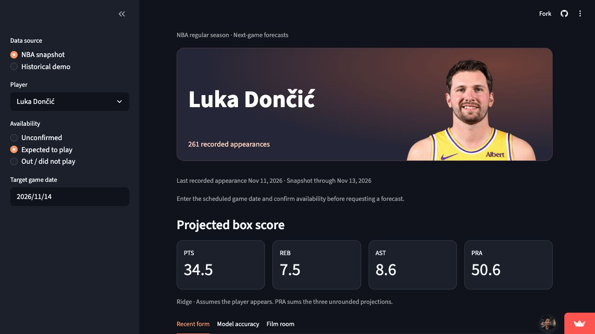

# CourtIQ

[**Open the live CourtIQ dashboard**](https://nba-player-predictor-bytzul.streamlit.app/)



*Example forecast for Luka Dončić using the November 13, 2026 data snapshot.*

I built CourtIQ to see whether a player's recent box scores could improve on a simple five-game average. It started as a Luka Doncic points predictor. I expanded it into a Streamlit app that forecasts points, rebounds, assists and their sum (PRA) for Luka, Kyrie Irving, Jayson Tatum, Shai Gilgeous-Alexander and Jalen Brunson.

I built the data pipeline, trained a separate model for each player and tested the forecasts on games played after the training period. On the 249 held-out appearances, Ridge beat the five-game average for points for three of the five players and for PRA for two. The app shows both methods' errors, so it's easy to see where the extra modeling helped.

Start with [the Python dashboard](app.py) or [the forecasting code](src/model.py). The [original notebook](nba_player_predictor.ipynb) records my first Luka scoring experiment.

[How I tested it](#how-i-checked-the-forecasts) · [Results by player](#results-from-the-included-snapshot) · [Run it locally](#run-it)

## Run it

Use Python 3.10 or 3.11. These commands download the project and start the app.

```bash
git clone https://github.com/Mykeil-tzul/nba-player-predictor.git
cd nba-player-predictor
python3 -m venv .venv
source .venv/bin/activate
python -m pip install -r requirements.txt
python -m streamlit run app.py
```

Open the local address printed in your terminal. The repository includes the five-player snapshot and fitted models used for the results below. The stats and forecasts use local files. The portraits and film links require an internet connection.

1. Choose a player and enter the date of their next scheduled game.
2. If you expect the player to appear, select **Expected to play**. The forecast assumes the player gets on the floor.
3. Open **Recent form** to see the games behind the forecast, **Model accuracy** to see how far estimates missed on later games, or **Film room** for the player's NBA highlights.
4. Use **Historical demo** to try a hypothetical date with the original partial 2024–25 dataset. Luka's demo uses a five-game average because his sample in that file is too small to fit and test a Ridge model.

## Where the data comes from

I started with the original single-season CSV in this repository. For the forecasting version I collected NBA Stats box scores through the [nba_data archive](https://github.com/llimllib/nba_data), which publishes season files. I filtered for the five players and regular-season game IDs. The included dataset has **1,281 appearances across 2022–23 through November 13, 2026**, including the 2026–27 season in progress.

Each row is one game a player appeared in. It includes the game ID and date, matchup, minutes, points, rebounds, assists, field-goal attempts and free-throw attempts. If a player misses a game, there is no appearance to learn from. A missed game would pull the averages down incorrectly if it were recorded as a zero-point performance.

Player portraits and highlight links come from NBA.com. The Film room also links to the latest recorded game's NBA game center when using the NBA snapshot.

## What the model sees before tipoff

For each player, I sort their games by date. For every game I want to predict, I look back at their previous game and their averages over the previous 3, 5 and 10 appearances. I also include how many days have passed since their last appearance. That gap can come from normal rest, injury or even an offseason, so I cap it at 30 days for training.

The most important detail is which row the numbers come from. If I'm predicting Friday, I can use Tuesday's minutes and shot attempts. Friday's actual minutes and attempts only become available after tipoff. The training and forecasting code both follow that rule.

I fit a separate Ridge regression for each player. Ridge is a linear model that limits how much weight it puts on any one input. That helps when features overlap, as the three-game and five-game averages often do. The model produces separate estimates for points, rebounds and assists. The app adds the unrounded estimates to get PRA.

## How I checked the forecasts

For each player, I fit the model using the earliest 80% of usable games and keep the latest 20% for evaluation. The model weights stay fixed during that test. For each test game, the inputs can include any earlier game that would already have been played at the time. I then refit on all usable games to produce the model used by the app.

I score all three methods on the same test games.

- **Last appearance** uses the player's previous box score.
- **Last five average** averages those stats over the player's last five appearances.
- **Ridge** uses the recent-history features described above.

I report mean absolute error (MAE), which is the average size of a miss. If a forecast is 28 points and the player scores 34, that's a six-point miss. PRA error is measured from the projected and actual sums.

### Results from the included snapshot

| Player | Held-out games | Points MAE · Ridge / last 5 | PRA MAE · Ridge / last 5 |
| --- | ---: | ---: | ---: |
| Luka Dončić | 51 | 7.94 / 7.82 | 9.12 / 9.68 |
| Kyrie Irving | 34 | 7.63 / 9.00 | 9.04 / 10.02 |
| Jayson Tatum | 48 | 7.73 / 5.98 | 8.15 / 7.71 |
| Shai Gilgeous-Alexander | 58 | 6.38 / 6.48 | 8.36 / 7.90 |
| Jalen Brunson | 58 | 6.42 / 6.58 | 7.50 / 7.17 |

Ridge was better than the five-game average on points for three players, but the margin was small for Shai and Brunson. The five-game average was better for Tatum on both points and PRA. For Luka, Ridge improved the PRA error while the five-game average did slightly better on points. The dashboard and training command show the full breakdown, including rebounds, assists and the last-appearance benchmark.

## Refresh the data and reproduce the results

The dashboard loads saved models for both modes. To train locally or refresh the data, install the training dependencies first.

```bash
python -m pip install -r requirements-training.txt
python -m src.train
```

To pull newer season files and retrain, run the importer before training.

```bash
python -m src.import_archive && python -m src.train
```

The archive importer can also read five local Parquet files named `2023.parquet` through `2027.parquet` using `--archive-dir`. The other collection route, `python -m src.fetch_data`, goes directly to NBA Stats. It caches player-season responses and retries temporary failures. I added the archive importer after the direct endpoint repeatedly timed out. Both routes publish the same CSV format.

The game snapshot is `data/games.csv`. Training writes `artifacts/courtiq.json` with the model coefficients, scores and a fingerprint of the snapshot. If the data changes, the app asks for fresh training so the displayed scores and forecasts come from the same snapshot.

A forecast is conditional on the player appearing. CourtIQ relies on the date and availability selected in the sidebar. It withholds forecasts for unconfirmed or out players and when the target date is more than 30 days after the last recorded appearance. The app flags older snapshots so the user knows when to refresh.

## What I'd test next

The app uses recent box scores and time since the player's last appearance. Opponent defense, lineup changes and minutes restrictions could explain some of the larger misses. I'd start by testing whether adding opponent defense improves points forecasts on a new stretch of games, using the same five-game average for comparison.

## Project layout

| File | What it does |
| --- | --- |
| `app.py` | Streamlit dashboard, player profiles, recent form, validation and film links |
| `src/import_archive.py` | Downloads or imports NBA season files |
| `src/fetch_data.py` | Collects and caches player game logs directly from NBA Stats |
| `src/data.py` | Validates game records and reads the local snapshot |
| `src/model.py` | Builds pregame features, fits Ridge and computes holdout errors |
| `src/train.py`, `src/predict.py` | Train models and request forecasts from the terminal |
| `tests/`, `.github/workflows/ci.yml` | Test the data pipeline, model behavior and dashboard on GitHub Actions |

Run the tests with `python -m unittest discover -s tests -v`. They check that the target game's stats stay out of the features, the holdout comes after training, PRA error uses the summed forecast and the dashboard respects player availability. They also check that all five included models can produce a projection without an API call.

The original Luka notebook is still in the repository. Its plotting cells require `matplotlib`.
